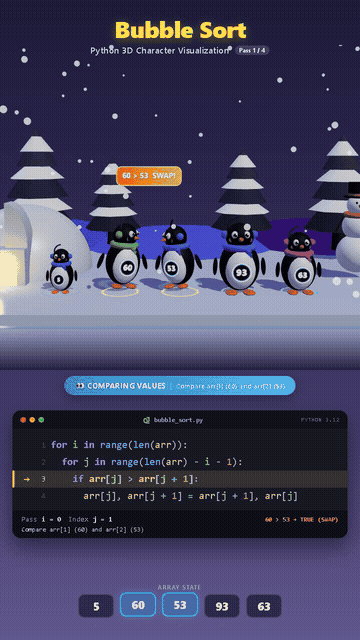
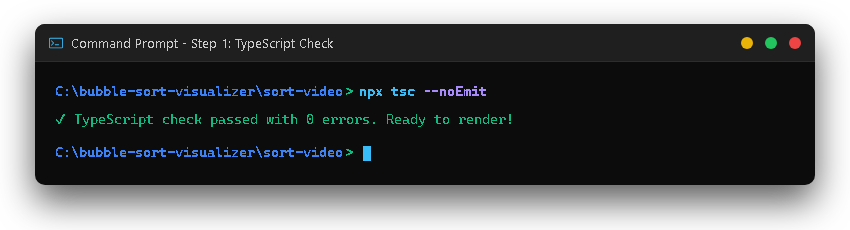
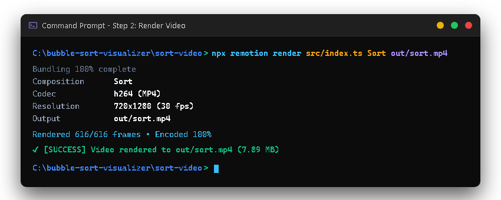
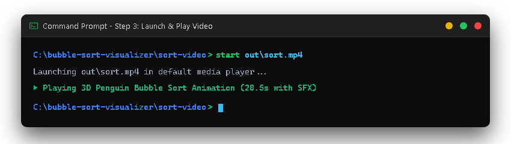

# 🐧 Bubble Sort 3D Video Animation & Visualizer

<p align="center">
  
</p>

<p align="center">
  <b>A cinematic 3D code animation demonstrating the Bubble Sort algorithm.</b><br>
  Built with <b>Remotion</b>, <b>React Three Fiber (Three.js)</b>, and <b>TypeScript</b>.
</p>

<p align="center">
  
  
  
  
  
</p>

---

## 💡 About The Project

This repository contains a programmatic video animation of the **Bubble Sort** algorithm sorting the array `[5, 60, 53, 93, 63]`. 

Instead of traditional static bar charts, this animation combines **3D character graphics** and **code execution tracing**:
- 🐧 **3D Penguin Characters**: Each number in the array is represented by an animated 3D penguin wearing colorful accessories that jumps and swaps positions.
- 💻 **Real-Time Code Tracking**: A dark-mode IDE panel highlights the exact lines of Python code executing at each millisecond, tracking passes `i`, loop indices `j`, and comparison conditions.
- 🔊 **Synchronized Sound Effects**: Custom procedural audio effects for comparisons (ticking), swaps (whoosh), sorted locks (ding), and completion celebration.

---

## 🚀 Quick Start Guide

Follow these simple steps in your terminal or Command Prompt to compile and generate the video on your computer.

### Step 0: Open Project & Install Dependencies

Open your terminal, navigate into `sort-video`, and install the required packages:

```cmd
cd sort-video
npm install
```

---

### Step 1: Verify Code & Types

Run the TypeScript compiler to ensure all code types and components are valid:

```cmd
npx tsc --noEmit
```

<p align="center">
  
</p>

---

### Step 2: Render the Animation Video

Render the 3D composition frame-by-frame into a full HD MP4 video (`out/sort.mp4`):

```cmd
npx remotion render src/index.ts Sort out/sort.mp4
```

<p align="center">
  
</p>

---

### Step 3: Watch the Video

Play the rendered video directly from your command line:

```cmd
start out\sort.mp4
```

> **Note for macOS/Linux users:**  
> - **macOS:** `open out/sort.mp4`  
> - **Linux:** `xdg-open out/sort.mp4`

<p align="center">
  
</p>

---

## 🎨 Interactive Live Preview (Remotion Studio)

If you'd like to inspect the animation live in your web browser with a full scrubber, camera controls, and instant hot-reload:

```cmd
npm run dev
```

This will launch **Remotion Studio** at `http://localhost:3000`.

---

## 📂 Project Structure

```text
bubble-sort-visualizer/
├── assets/                  # Demo GIF, preview poster, and terminal screenshots
│   ├── demo.gif             # Looping animation preview for README
│   ├── preview.png          # High-resolution animation poster
│   ├── cmd-1-tsc.png        # Step 1 terminal screenshot
│   ├── cmd-2-render.png     # Step 2 terminal screenshot
│   └── cmd-3-play.png       # Step 3 terminal screenshot
└── sort-video/              # Remotion video source project
    ├── src/
    │   ├── Sort.tsx         # Master composition & layout sequencing
    │   ├── Scene.tsx        # 3D canvas, camera staging, and lighting
    │   ├── Penguin.tsx      # 3D penguin geometry & jump/swap motion
    │   ├── CodePanel.tsx    # Python code display & active line highlighter
    │   ├── Environment.tsx  # Winter landscape, falling snow & igloo
    │   ├── AudioTracks.tsx  # Sound effect synchronization with animation
    │   └── trace.ts         # Precalculated Bubble Sort execution steps
    ├── public/              # Synthesized .wav audio assets
    ├── package.json         # Project dependencies & scripts
    └── tsconfig.json        # TypeScript configuration
```

---

## 🛠️ Tech Stack

- **[Remotion](https://www.remotion.dev/)**: Programmatic video creation in React.
- **[React Three Fiber](https://r3f.docs.pmnd.rs/) & [Three.js](https://threejs.org/)**: Declarative 3D rendering for penguins and the winter environment.
- **[TypeScript](https://www.typescriptlang.org/)**: Strict typing for predictable animations and trace management.
- **Web Audio API**: Procedurally generated audio sound effects.

---

<p align="center">
  ⭐ <i>Star this repository if you find this animation helpful or fun to learn from!</i>
</p>
